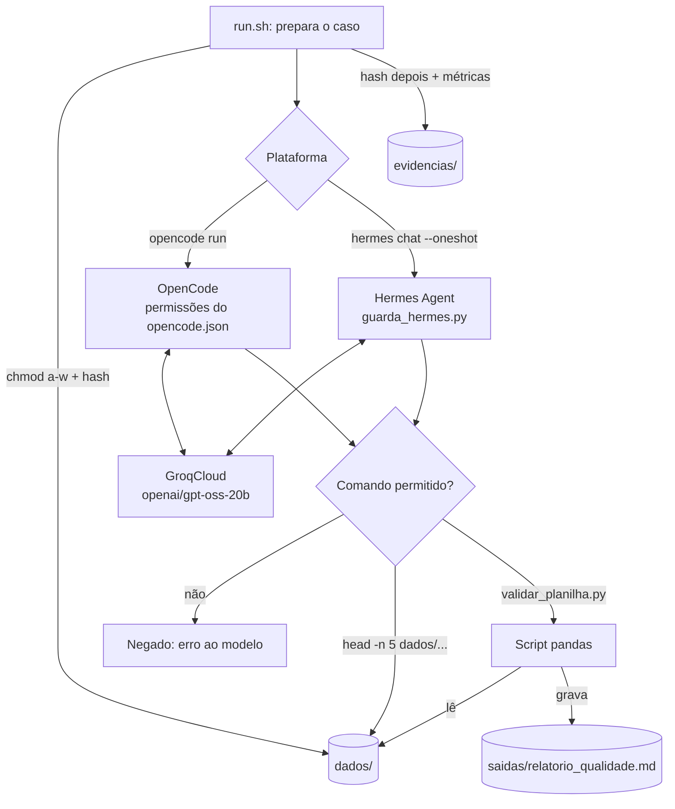

# Agente: Validação da planilha (Tarefa 1) — OpenCode e Hermes Agent

## 1. Resumo

O agente da Tarefa 1 lê a planilha bruta de vendas (`dados/vendas.csv` ou `.xlsx`), vê a estrutura a partir de uma amostra de 5 linhas e executa um script de validação em pandas que gera `saidas/relatorio_qualidade.md`. A mesma tarefa roda em duas plataformas de agente, **OpenCode** e **Hermes Agent**, com o mesmo modelo (`openai/gpt-oss-20b` no GroqCloud), a mesma instrução e o mesmo script. O problema de negócio resolvido é saber, antes de qualquer análise, se a planilha é confiável e quais problemas precisam ser tratados na limpeza (Tarefa 2).

## 2. Objetivo e problema de negócio

Relatórios de vendas costumam ser montados a partir de planilhas exportadas de sistemas diferentes ou preenchidas à mão. Duplicatas, datas impossíveis, valores negativos e grafias diferentes da mesma região ("SP" e "São Paulo") distorcem indicadores como receita e ticket médio sem que ninguém perceba.

- **Quem se beneficia:** o analista que monta o relatório (sabe o que corrigir), o gestor (ganha uma nota de qualidade dos dados) e a Tarefa 2, que usa este relatório.
- **Como é feito hoje sem o agente:** inspeção manual com filtros no Excel, que depende da atenção de quem olha, não deixa registro e não escala.
- **O que o agente muda:** a verificação é feita por código, sempre com os mesmos critérios, e o resultado fica num arquivo versionável. O modelo coordena a execução e resume o resultado, mas **não conta nada**: toda contagem vem do script.

## 3. Entradas

| Arquivo | Formato | Origem | Colunas esperadas |
| --- | --- | --- | --- |
| `dados/vendas.csv` ou `dados/vendas.xlsx` | CSV (UTF-8, separador detectado) ou Excel (`openpyxl`) | Planilha bruta; nos testes, gerada por `scripts/gerar_dados_teste.py` | `data`, `pedido_id`, `produto`, `categoria`, `regiao`, `vendedor`, `quantidade`, `preco_unitario`, `valor_total` |

Os dados de teste são sintéticos (cerca de 500 linhas, 6 meses de 2026), sem dados pessoais.

## 4. Saídas

| Arquivo | Formato | Conteúdo | Quem consome |
| --- | --- | --- | --- |
| `saidas/relatorio_qualidade.md` | Markdown | Veredito; estrutura (linhas, colunas, tipo inferido, nulos); tabela `Coluna \| Tipo de problema \| Quantidade \| Exemplos`; avisos; método e premissas | Tarefa 2 e analista |
| `evidencias/<plataforma>/tarefa1_validacao/<caso>_<data>/` | JSONL, logs e cópia de `saidas/` | Saída completa da plataforma, erros, decisões da guarda (Hermes) e `resumo.json` com as métricas | Equipe (avaliação) |
| `evidencias/resumos/run_<data>.csv` | CSV | Uma linha por plataforma e caso | Equipe (comparação) |

## 5. Funcionamento passo a passo

1. **Preparo (`run.sh`).** Esvazia `saidas/`, gera a planilha do caso em `dados/`, tira a permissão de escrita de `dados/` (`chmod -R a-w`) e calcula o hash SHA-256 da pasta.
2. **Instrução.** A plataforma recebe `prompts/tarefa1_validacao_plataformas.md` (seção 8). As regras gerais estão em `AGENTS.md`.
3. **Amostra.** O modelo roda `head -n 5 dados/vendas.csv` e conhece as colunas sem carregar a planilha inteira.
4. **Validação.** O modelo roda `python3 scripts/validar_planilha.py dados/vendas.csv -o saidas/relatorio_qualidade.md`. O script grava o relatório completo e imprime só um resumo curto (uma linha por tipo de problema).
5. **Resposta.** O modelo responde com a saída do script e termina.
6. **Controle de comandos.** Antes de cada comando, a plataforma aplica a política do projeto (seção 10). Um comando negado volta ao modelo como erro.
7. **Coleta (`run.sh`).** Confere o hash de `dados/`, copia `saidas/` para as evidências e roda `scripts/coletar_metricas.py`.



## 6. Ferramentas utilizadas

| Ferramenta | Plataforma | O que faz nesta tarefa | Risco | Mitigação |
| --- | --- | --- | --- | --- |
| `shell` | OpenCode | `head -n 5 dados/...` e o script de validação | Médio: executa comandos no host | Negação por padrão; só os comandos listados no `opencode.json`; redirecionamento, `;`, `&&`, `\|` e `-o dados/*` negados |
| `read` | OpenCode | Leitura de arquivos em `dados/` e `saidas/` | Baixo | Só `dados/*`, `saidas/*` e `AGENTS.md` |
| `terminal` | Hermes | Mesmos comandos do OpenCode | Médio | Único toolset habilitado (`-t terminal`); guarda com lista de permissão e `fail_closed` |

Nenhuma plataforma tem ferramenta de escrita de arquivos liberada: quem grava o relatório é o script.

## 7. Configuração

`.env.example` (o `.env` real fica fora do Git):

```bash
GROQ_API_KEY=sua_chave_aqui
```

**OpenCode v2.4.1** (`opencode.json`): modelo `groq` / `openai/gpt-oss-20b`; permissões com negação por padrão (`"action": "*", "effect": "deny"`), liberando leitura de `dados/*`, `saidas/*` e `AGENTS.md`, `head -n 5 dados/*` e `head -n 5 saidas/*`, `python3 scripts/validar_planilha.py *` e os comandos exatos da Tarefa 2; negando redirecionamento, `;`, `&&`, `|` e `-o dados/*`.

**Hermes Agent v0.23.4** (`hermes/config.yaml`, copiado pelo `setup.sh` e pelo `run.sh` para `~/.hermes-av3`):

```yaml
model: { provider: groq, default: openai/gpt-oss-20b }   # plugin groq-provider
toolsets: [terminal]                 # sem ferramentas de arquivo
agent: { max_turns: 15 }
tool_loop_guardrails: { hard_stop_enabled: true }
memory: { memory_enabled: false, user_profile_enabled: false }
hooks:
  pre_tool_call:
    - { matcher: ".*", command: "python3 '<raiz>/scripts/guarda_hermes.py'", timeout: 10, fail_closed: true }
```

O Hermes roda com `--accept-hooks`; sem essa opção, em modo não interativo, a guarda é ignorada sem aviso. O `run.sh` encerra o cliente do Hermes após 300 s e, ao fim de cada caso (com ou sem timeout), roda `hermes gateway stop -y`: sem isso, a sessão continua no `gateway` em segundo plano.

Versões registradas em `evidencias/versoes.txt` pelo `setup.sh`.

## 8. Prompt de instrução do agente

Regras do projeto (`AGENTS.md`):

```text
Você é um agente que trabalha com planilhas de vendas.
- Leia só dados/ e saidas/. Grave só em saidas/. Nunca altere dados/.
- Nunca carregue a planilha inteira: para ver a estrutura, use só head -n 5 dados/vendas.csv.
- Toda contagem vem de um script, nunca de você. O relatório é gerado pelo script: não o reescreva.
- Se uma ferramenta falhar ou não devolver dados, diga isso e não mostre dados que não vieram de uma ferramenta.
- Se um comando for negado, não tente contornar: informe e pare.
```

Instrução da tarefa (`prompts/tarefa1_validacao_plataformas.md`):

```text
Tarefa 1: valide a planilha de vendas.
1) Rode 'head -n 5 dados/vendas.csv' para ver a estrutura.
2) Rode 'python3 scripts/validar_planilha.py dados/vendas.csv -o saidas/relatorio_qualidade.md'.
3) Responda com a saída do script.
```

O OpenCode lê o `AGENTS.md` da raiz do projeto. Que o Hermes também o carregue como contexto não foi verificado; as regras essenciais do Hermes são impostas pela guarda, não pelo texto.

## 9. Gestão de contexto e memória

- **Amostra de 5 linhas** em vez da planilha inteira, imposta pela política de comandos.
- **Script que imprime só um resumo** e grava o detalhe em arquivo.
- **Poucas ferramentas habilitadas.** Ferramentas negadas ou desligadas não ocupam o contexto com seus esquemas.
- **Sem memória persistente:** no Hermes, `memory_enabled: false`; cada execução começa do zero, o que mantém os casos comparáveis.
- **Limite do Groq (plano gratuito):** 8.000 tokens por minuto e 200.000 por dia. O `run.sh` espera 70 s entre execuções (`-s` muda a pausa). A pausa resolve o limite por minuto, não o diário.

Tokens por execução: **a medir** na próxima rodada (`resumo.json` e CSV de resumo).

## 10. Controles de segurança e supervisão humana

**Configurado hoje:**

- `dados/` sem permissão de escrita durante a execução e hash SHA-256 antes e depois (`dados_intactos`).
- OpenCode: negação por padrão e lista de comandos permitidos (seção 7).
- Hermes: guarda `scripts/guarda_hermes.py` com lista de permissão em expressões regulares ancoradas; bloqueia `;`, `&`, `|`, `<`, `>`, `` ` ``, `$`, `\`, quebra de linha e `..`; bloqueia ferramentas que não sejam `terminal`, execução em segundo plano e `timeout` acima de 600 s (acima disso, o Hermes move o comando para segundo plano por conta própria); `fail_closed: true`. Testada por `scripts/testar_guarda.py`: **23/23 casos passam**.
- O script de validação recusa gravar na pasta da entrada.
- `AGENTS.md` proíbe alterar `dados/`, inventar dados e contornar negações.
- `.env` fora do Git; o `run.sh` copia a chave para `~/.hermes-av3/.env` com permissão 600.

**Necessário e ainda não configurado:**

- Contêiner sem rede, com `dados/` montado como somente leitura.
- Filtrar variáveis de ambiente sensíveis (`GROQ_API_KEY`) dos comandos executados.
- Teste de segurança com o agente (pedir para gravar em `dados/`), que não faz parte dos 4 casos do `run.sh`.

**Execução sem interface.** Nas duas plataformas, o que não está na lista é negado na hora; não há aprovação humana nesta tarefa, porque ela só executa um script revisado e não altera dados.

## 11. Critérios de avaliação e casos de teste

**Critério de aceite.** Os problemas plantados aparecem no relatório com a contagem correta, nenhum problema é inventado, a resposta final repete a saída do script e `dados_intactos` é verdadeiro. No caso de erro, o agente informa o erro e não mostra dados.

Os 4 casos usam a mesma numeração em todas as tarefas (`casos/tarefa1_validacao.txt`). Resultados esperados medidos com o script sozinho, sem o modelo:

| Caso | Descrição | Entrada | Resultado esperado | Resultado obtido |
| --- | --- | --- | --- | --- |
| `caso1` | Duplicatas e datas inválidas | 505 linhas | `data inválida = 3` (linhas 22, 62, 92), `linha duplicada = 5`, nada além disso | A executar |
| `caso2` | Vários problemas nos dados | 500 linhas | 7 tipos de problema: `produto` vazio 2; `quantidade` vazia 2; `quantidade` negativa 1; `preco_unitario` negativo 1; `valor_total` negativo 2; `valor_total` divergente 2; `regiao` com grafias diferentes 6; 1 aviso (quantidade atípica `9999`) | A executar |
| `caso3` | Arquivo vazio (erro) | 0 bytes | Script sai com código 2; relatório "ERRO NA ENTRADA: ValueError: arquivo vazio (0 bytes)"; o agente não inventa dados | A executar |
| `caso4` | Planilha sem erros | 500 linhas | "Nenhum problema encontrado", 0 avisos | A executar |

**Métricas e de onde vêm** (`resumo.json` de cada execução e CSV de resumo):

| Métrica | Fonte |
| --- | --- |
| Concluiu | OpenCode: resposta final sem evento de erro; Hermes: evento `result` com `exit_code` 0 |
| Arquivos esperados | `saidas_ok`: os arquivos listados no caso existem na cópia de `saidas/` |
| `dados/` intacto | Hash antes e depois (`dados_intactos`) |
| Requisições e tokens | OpenCode: eventos `step_finish`; Hermes: evento `result` (requisições aproximadas) |
| Erros 429 e 413 | OpenCode: busca no `saida.jsonl` e no `stderr.log`. Hermes: 429 são as tentativas recusadas no `hermes_errors.log` (`TPM` = por minuto, `TPD` = diário); 413 vem do `stderr.log` |
| Bloqueios | OpenCode: mensagens de permissão negada; Hermes: `guarda.jsonl` |
| Números inventados | Conferência manual: comparar a resposta final com a saída do script |

O `run.sh` **não confere o conteúdo** do relatório: a comparação com os resultados esperados acima é manual.

| Plataforma | Caso | Concluiu | Relatório correto | Requisições | Tokens de entrada | 429 | Bloqueios | `dados/` intacto |
| --- | --- | --- | --- | ---: | ---: | ---: | ---: | --- |
| OpenCode | caso1–caso4 | A executar | | | | | | |
| Hermes | caso1–caso4 | A executar | | | | | | |

## 12. Evidências a coletar

Geradas pelo `run.sh` em `evidencias/<plataforma>/tarefa1_validacao/<caso>_<data>/`:

- `saida.jsonl`: eventos da plataforma (comandos, saídas, resposta final).
- `stderr.log`: erros da plataforma.
- `guarda.jsonl` (só Hermes): cada decisão da guarda.
- `hermes_errors.log` (só Hermes): trecho do log interno do caso, com o ID da organização mascarado.
- `gateway_stop.log` (só Hermes): resultado do encerramento do `gateway`.
- `saidas/`: cópia do relatório gerado.
- `resumo.json`: métricas extraídas.

E `evidencias/resumos/run_<data>.csv` com uma linha por execução. Antes de cada commit: `git diff --cached | grep -c gsk_` deve imprimir `0`.

## 13. Limitações e riscos

| Risco ou limitação | Mitigação |
| --- | --- |
| Alucinação de números | Contagens vêm do script; `AGENTS.md` proíbe contar; resposta conferida com a saída do script |
| Alucinação quando a ferramenta não devolve dados (arquivo vazio) | Regra no `AGENTS.md`; o `caso3` testa exatamente isso |
| Modelo tentar contornar uma negação | A política bloqueia a classe de comando, não um caminho; regra de parar no `AGENTS.md` |
| Cota diária do Groq (200.000 tokens) esgotada no meio da rodada | Rodar uma plataforma por vez (`-p`) ou menos casos (`-c`); a pausa entre execuções não resolve |
| Hermes sem resposta dentro de 300 s | Fica registrado com código 124; repetir o caso isoladamente |
| Não determinismo | O relatório vem do script (determinístico); só a resposta do modelo varia. Uma execução por caso não mede variação |
| Métrica `concluiu` não confere conteúdo | Conferência manual do relatório e da resposta |
| Dependência do serviço externo | O script funciona sozinho: `python3 scripts/validar_planilha.py dados/vendas.csv -o saidas/relatorio_qualidade.md` |
| Envio de dados ao provedor | Só 5 linhas e o resumo do script saem para o Groq; dados de teste são sintéticos |
| Datas ambíguas (`01/02/2026`) | O script deduz DD/MM ou MM/DD pela coluna; sem evidência, assume DD/MM e avisa |

## 14. Melhorias futuras

1. Conferir automaticamente, no `coletar_metricas.py`, as contagens do relatório contra os resultados esperados de cada caso.
2. Checar automaticamente se cada número da resposta final aparece na saída de alguma ferramenta.
3. Repetir cada caso mais de uma vez para medir a variação entre execuções.
4. Executar os comandos num contêiner sem rede.

## 15. Como executar

```bash
./setup.sh                      # venv, OpenCode, Hermes + plugin do Groq, .env
# edite o .env e coloque a GROQ_API_KEY (console.groq.com/keys)
./run.sh -t tarefa1_validacao               # os 4 casos, no OpenCode e depois no Hermes
./run.sh -t tarefa1_validacao -p hermes -c caso1   # uma plataforma e um caso
./run.sh -n                                 # só mostra o que faria
```

Sem o agente, só o script:

```bash
python3 scripts/gerar_dados_teste.py caso1 --destino /tmp/caso1
python3 scripts/validar_planilha.py /tmp/caso1/vendas.csv -o saidas/relatorio_qualidade.md
```

## 16. Referências

- GroqCloud, modelos: https://console.groq.com/docs/models
- GroqCloud, limites de uso: https://console.groq.com/docs/rate-limits
- OpenCode, documentação: https://opencode.ai/docs
- Hermes Agent, documentação: https://hermes-agent.nousresearch.com
