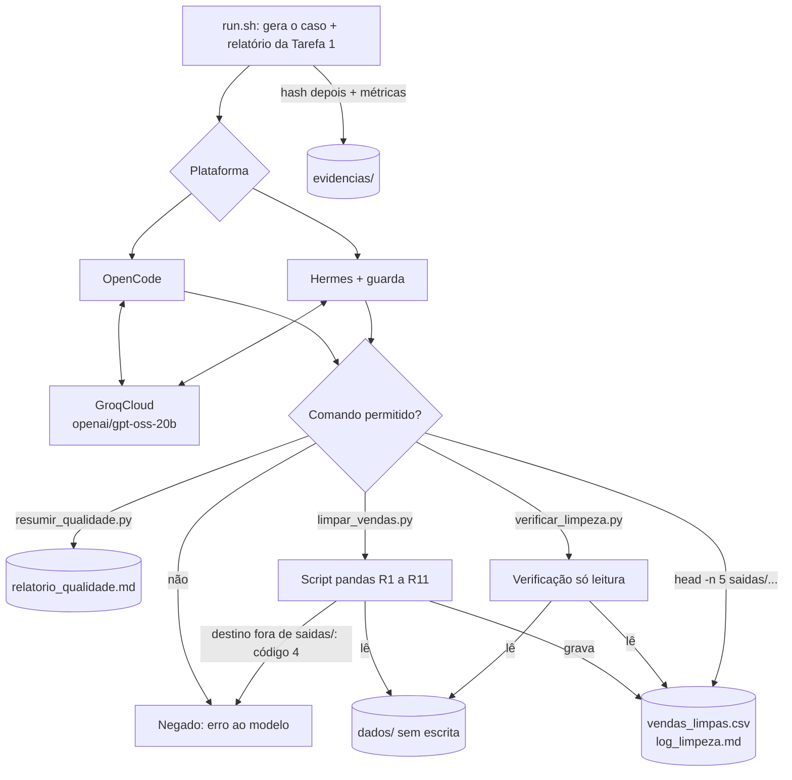

# Agente: Limpeza e padronização dos dados (Tarefa 2) — OpenCode e Hermes Agent

## 1. Resumo

O agente da Tarefa 2 lê os problemas apontados pela Tarefa 1 (`saidas/relatorio_qualidade.md`), executa um script de limpeza em pandas sobre a planilha bruta e grava uma cópia limpa (`saidas/vendas_limpas.csv`) e um log de decisões (`saidas/log_limpeza.md`). Depois roda uma verificação automática que confere o log contra os arquivos. A tarefa roda no **OpenCode** e no **Hermes Agent**, com o modelo `openai/gpt-oss-20b` no GroqCloud. O problema de negócio resolvido é ter uma base de vendas única e confiável para calcular indicadores, com cada linha removida ou corrigida justificada.

## 2. Objetivo e problema de negócio

A Tarefa 1 diz **o que** está errado na planilha; a Tarefa 2 decide **o que fazer** com cada problema. Sem essa etapa, os indicadores somariam vendas duplicadas, perderiam vendas com data em outro formato, tratariam "SP" e "São Paulo" como regiões diferentes e usariam `valor_total` digitado errado.

- **Quem se beneficia:** o analista (deixa de limpar à mão e tem um log para justificar os números), o gestor (as correções estão documentadas) e as tarefas seguintes, que recebem um CSV num formato único.
- **Como é feito hoje sem o agente:** filtros e "localizar e substituir" no Excel, com decisões caso a caso e sem registro.
- **O que o agente muda:** as decisões ficam **fixadas como regras** (R1 a R11, seção 8), implementadas num script revisado pela equipe. O script registra o que removeu e alterou, e uma verificação independente confere o log. O modelo coordena e resume; ele **não corrige nem conta nada**.

## 3. Entradas

| Arquivo | Formato | Origem | Campos esperados |
| --- | --- | --- | --- |
| `dados/vendas.csv` ou `.xlsx` | CSV ou Excel | Planilha bruta (a mesma da Tarefa 1) | `data`, `pedido_id`, `produto`, `categoria`, `regiao`, `vendedor`, `quantidade`, `preco_unitario`, `valor_total` |
| `saidas/relatorio_qualidade.md` | Markdown | **Tarefa 1** (no `run.sh`, gerado pelo script no preparo do caso) | "Linhas de dados: **N**" e a tabela de problemas |
| `gabaritos/<caso>/vendas_limpas.csv` (só na avaliação) | CSV | `scripts/gerar_dados_teste.py <caso> --gabarito gabaritos/<caso>` | Resultado esperado da limpeza |

O **gabarito** não é lido pelo agente: é montado pelo gerador a partir da planilha base e do que foi plantado, **sem usar o script de limpeza**, e serve para a equipe conferir o resultado. Não há gabarito para o `caso3` (arquivo vazio), porque a limpeza deve falhar.

## 4. Saídas

| Arquivo | Formato | Conteúdo | Quem consome |
| --- | --- | --- | --- |
| `saidas/vendas_limpas.csv` | CSV UTF-8 | As 9 colunas; datas `AAAA-MM-DD`; `quantidade` inteira; preço e total com ponto e 2 casas; `regiao` como sigla de UF; sem duplicatas nem vazios | Tarefas seguintes (indicadores, gráficos) |
| `saidas/log_limpeza.md` | Markdown | Contagens antes e depois; regras; remoções e alterações por motivo; cada linha removida, alterada ou mantida para revisão; bloco JSON de contagens | Analista, gestor, `verificar_limpeza.py` |
| `evidencias/<plataforma>/tarefa2_limpeza/<caso>_<data>/` | JSONL, logs, cópia de `saidas/` | Igual à Tarefa 1 | Equipe |

Com entrada inválida **não há CSV**, só o log com o erro. Um `vendas_limpas.csv` antigo é apagado, para nenhuma tarefa seguinte usar dados de outra planilha.

## 5. Funcionamento passo a passo

1. **Preparo (`run.sh`).** Esvazia `saidas/`, gera a planilha do caso, roda a validação da Tarefa 1 (script) para criar o relatório, tira a escrita de `dados/` e calcula o hash.
2. **Instrução.** A plataforma recebe `prompts/tarefa2_limpeza_plataformas.md` (seção 8) e as regras do `AGENTS.md`.
3. **Ler a Tarefa 1.** `python3 scripts/resumir_qualidade.py saidas/relatorio_qualidade.md`: uma linha por problema, com o tratamento que a limpeza vai aplicar.
4. **Limpar.** `python3 scripts/limpar_vendas.py dados/vendas.csv -o saidas/vendas_limpas.csv --log saidas/log_limpeza.md`. Imprime contagens, remoções, alterações e avisos. Com entrada inválida, imprime `ERRO NA ENTRADA` e sai com código 2; a instrução manda informar e parar.
5. **Verificar.** `python3 scripts/verificar_limpeza.py dados/vendas.csv saidas/vendas_limpas.csv saidas/log_limpeza.md`: uma linha `OK` ou `FALHA` por checagem e o total.
6. **Observar.** `head -n 5 saidas/vendas_limpas.csv`.
7. **Responder.** Copia literalmente as linhas `Linhas:`, `Remoções:`, `Alterações:` e `Verificação:`.
8. **Coleta (`run.sh`).** Hash de `dados/`, cópia de `saidas/` e métricas.



## 6. Ferramentas utilizadas

As mesmas da Tarefa 1 (`shell` e `read` no OpenCode; `terminal` no Hermes), com estes comandos a mais liberados, sempre na forma exata:

| Comando | Para quê | Grava? |
| --- | --- | --- |
| `python3 scripts/resumir_qualidade.py saidas/relatorio_qualidade.md` | Resumo do relatório da Tarefa 1 | Não |
| `python3 scripts/limpar_vendas.py dados/vendas.csv -o saidas/vendas_limpas.csv --log saidas/log_limpeza.md` | Limpeza | Só em `saidas/` |
| `python3 scripts/verificar_limpeza.py dados/vendas.csv saidas/vendas_limpas.csv saidas/log_limpeza.md` | Verificação | Não |
| `head -n 5 saidas/*` | Ver o formato final | Não |

Nenhuma ferramenta de escrita de arquivos é liberada: o modelo não pode "consertar" o CSV nem reescrever o log.

Scripts da equipe (em `scripts/`):

| Script | Papel | Códigos de saída |
| --- | --- | --- |
| `limpar_vendas.py` | Aplica R1 a R11, grava CSV e log | 0 ok; 2 entrada inválida; 4 destino recusado |
| `resumir_qualidade.py` | Resume o relatório da Tarefa 1 | 0 ok; 2 relatório inexistente |
| `verificar_limpeza.py` | Confere log × arquivos (× gabarito, com `--gabarito`) | 0 tudo OK; 1 alguma falha |
| `testar_limpeza.py` | Testa o script de limpeza sem o modelo | 0 todos passaram; 1 alguma falha |

## 7. Configuração

A mesma da Tarefa 1 (`opencode.json`, `hermes/config.yaml`, `scripts/guarda_hermes.py`, `.env`). Os comandos da seção 6 estão liberados nos dois: regras exatas no `opencode.json` e expressões regulares ancoradas na guarda do Hermes.

## 8. Prompt de instrução do agente

Regras gerais: `AGENTS.md` (ver Tarefa 1). Instrução da tarefa (`prompts/tarefa2_limpeza_plataformas.md`):

```text
Tarefa 2: limpe e padronize a planilha de vendas.
Regras fixas, já implementadas no script (não as mude): duplicatas exatas saem; datas vão para AAAA-MM-DD e linha com data inválida ou vazia sai; números usam ponto decimal; se falta só um entre quantidade, preço e valor_total, ele é recalculado pela conta, se faltam dois a linha sai; valor_total divergente é recalculado; quantidade negativa é devolução e fica; preço negativo ou zero é erro e a linha sai; texto vazio vira 'Não informado'; região vira sigla de UF ('São Paulo' -> 'SP'); valores atípicos ficam e vão para revisão humana.
1) Rode 'python3 scripts/resumir_qualidade.py saidas/relatorio_qualidade.md' para ver os problemas apontados na Tarefa 1.
2) Rode 'python3 scripts/limpar_vendas.py dados/vendas.csv -o saidas/vendas_limpas.csv --log saidas/log_limpeza.md'. Se ele terminar com ERRO, informe o erro e pare.
3) Rode 'python3 scripts/verificar_limpeza.py dados/vendas.csv saidas/vendas_limpas.csv saidas/log_limpeza.md'.
4) Rode 'head -n 5 saidas/vendas_limpas.csv'.
5) Responda copiando literalmente, sem reescrever: as linhas que começam com 'Linhas:', 'Remoções:' e 'Alterações:' da saída do passo 2 e a linha 'Verificação:' do passo 3. Não escreva linhas da planilha nem tabelas.
```

### Decisões fixadas (implementadas em `limpar_vendas.py`)

| Regra | Decisão | Motivo |
| --- | --- | --- |
| R1 Espaços | Removidos nas pontas; repetidos viram um | " Mouse " e "Mouse" são o mesmo produto |
| R2 Duplicatas exatas | Removidas; fica a primeira | Cópia da mesma venda infla a receita |
| R3 Datas | Formato `AAAA-MM-DD`; `DD/MM/AAAA` convertido (ordem deduzida da coluna). Vazia, inexistente ou ilegível: **linha removida** | Inventar uma data distorce a receita mensal |
| R4 Números | Ponto decimal; `quantidade` inteira; preço e total com 2 casas; `R$ 3.500,00` convertido | Formato único |
| R5 Nulos numéricos | Falta **um** entre quantidade, preço e total: recomposto pela conta exata. Faltam dois ou três: **linha removida** | Com um só valor, qualquer preenchimento seria inventado |
| R6 `valor_total` divergente | Recalculado como `quantidade × preco_unitario` (tolerância 0,02), valor antigo no log | O total é derivado |
| R7 Negativos | `quantidade` negativa = **devolução**, mantida. Preço negativo ou zero, quantidade zero ou não inteira = **erro**, linha removida | Devolução tem sentido de negócio; preço negativo não |
| R8 Texto vazio | Vira `Não informado` | A receita existe; o valor desconhecido não é adivinhado |
| R9 Padronização | `regiao` → sigla de UF; `produto`, `categoria`, `vendedor`: variantes de caixa, acento ou espaço → forma mais frequente | A mesma região escrita de dois jeitos divide a receita |
| R10 Duplicata após padronizar | Removida | Só aparece depois de R1 a R9 |
| R11 Revisão humana | Atípicos (fora de 3×IQR) e `pedido_id` repetido com conteúdo diferente **não são alterados**; ficam listados no log | Atípico não é erro provado |

## 9. Gestão de contexto e memória

- O modelo não lê a planilha bruta: o relatório da Tarefa 1 chega como resumo curto e só 5 linhas do CSV limpo são vistas.
- Os scripts imprimem resumos e gravam o detalhe em arquivo; o log completo nunca vai para o contexto.
- A instrução é maior que a da Tarefa 1, porque as regras de limpeza precisam estar nela.
- Sem memória persistente; a única ligação entre as tarefas é o arquivo `saidas/relatorio_qualidade.md`, lido por script.
- Limites do Groq: os mesmos da Tarefa 1 (8.000 tokens por minuto, 200.000 por dia).

Tokens por execução: **a medir** na próxima rodada.

## 10. Controles de segurança e supervisão humana

**Configurado hoje:**

- Tudo o que vale na Tarefa 1: `dados/` sem escrita e com hash, negação por padrão no OpenCode, guarda com `fail_closed` no Hermes, sem ferramenta de escrita, regras do `AGENTS.md`.
- **O script de limpeza só grava dentro de `saidas/`**: resolve o caminho real e recusa `..`, caminhos absolutos fora, a própria entrada e o relatório da Tarefa 1 (código 4, nada gravado).
- **Verificação automática** de que as contagens do log batem com os arquivos, de que toda linha removida ou alterada está justificada e de que **nenhum valor mudou sem registro**.
- **Saída antiga apagada em caso de erro** e aviso quando o relatório da Tarefa 1 tem outro número de linhas.

Testado sem o modelo (`python3 scripts/testar_limpeza.py`): **12/12 testes passam** (os 4 casos, 5 destinos recusados, 2 adulterações reprovadas pelo verificador e `dados/` intacto).

**Necessário e ainda não configurado:**

- Contêiner sem rede, com `dados/` somente leitura.
- Aprovação humana quando a limpeza remover mais de 10% das linhas.
- Revisão humana obrigatória das linhas marcadas para revisão (R11) antes das tarefas seguintes.
- Teste de segurança com o agente (pedir para gravar sobre `dados/vendas.csv`), fora dos 4 casos do `run.sh`.

## 11. Critérios de avaliação e casos de teste

**Critério de aceite.** Com entrada válida: o CSV tem as mesmas linhas e valores do gabarito (`verificar_limpeza.py --gabarito`, todas as checagens OK); `dados_intactos` verdadeiro; a resposta final copia as linhas dos scripts, sem números próprios. Com entrada inválida: nenhum CSV, log com o erro, e o agente informa e para.

Resultados esperados medidos com o script sozinho (`testar_limpeza.py`):

| Caso | Descrição | Resultado esperado | Resultado obtido |
| --- | --- | --- | --- |
| `caso1` | Duplicatas e datas inválidas | 505 → **497**; removidas 5 duplicatas (linhas 502 a 506) e 3 datas inválidas (linhas 22, 62, 92); 0 alteradas; igual a `gabaritos/caso1` | A executar |
| `caso2` | Vários problemas nos dados | 500 → **499**; removida 1 (preço `-10`, R7); **10 linhas alteradas**; 2 linhas para revisão (devolução `-3` e quantidade atípica `9999`); igual a `gabaritos/caso2` | A executar |
| `caso3` | Arquivo vazio (erro) | Script sai com código 2, sem CSV, log com "arquivo vazio (0 bytes)"; o agente informa e não roda os passos 3 e 4 | A executar |
| `caso4` | Planilha sem erros | 500 → **500**; 0 removidas, 0 alteradas (só a formatação numérica fica uniforme); igual a `gabaritos/caso4` | A executar |

No `caso2`, a linha `Alterações:` esperada é "quantidade vazia deduzida 2; região convertida para sigla de UF 6; texto vazio preenchido com 'Não informado' 2; valor_total divergente recalculado 2". São 12 alterações em 10 linhas, porque duas linhas têm mais de uma alteração.

**Como conferir contra o gabarito** (o `run.sh` não faz isso; rode depois, sobre a cópia nas evidências):

```bash
python3 scripts/gerar_dados_teste.py caso1 --destino /tmp/caso1
D=evidencias/opencode/tarefa2_limpeza/caso1_<data>
python3 scripts/verificar_limpeza.py /tmp/caso1/vendas.csv $D/saidas/vendas_limpas.csv $D/saidas/log_limpeza.md \
  --gabarito gabaritos/caso1/vendas_limpas.csv
```

**Atenção ao `caso3`:** ele não tem arquivos esperados, então `saidas_ok` aparece como verdadeiro mesmo se o agente falhar. Confira a resposta final e se não existe `vendas_limpas.csv` na cópia de `saidas/`.

Métricas: as mesmas da Tarefa 1, seção 11.

| Plataforma | Caso | Concluiu | Igual ao gabarito | Resposta fiel | Requisições | Tokens de entrada | 429 | Bloqueios | `dados/` intacto |
| --- | --- | --- | --- | --- | ---: | ---: | ---: | ---: | --- |
| OpenCode | caso1–caso4 | A executar | | | | | | | |
| Hermes | caso1–caso4 | A executar | | | | | | | |

## 12. Evidências a coletar

As mesmas da Tarefa 1, em `evidencias/<plataforma>/tarefa2_limpeza/<caso>_<data>/`, com `vendas_limpas.csv` e `log_limpeza.md` na cópia de `saidas/`. Guarde também a saída da conferência contra o gabarito (`verificacao.txt`).

## 13. Limitações e riscos

| Risco ou limitação | Mitigação |
| --- | --- |
| Modelo encerrar antes dos passos e inventar a resposta | Passo 5 pede para copiar só 4 linhas literais e proíbe tabelas; os arquivos são gravados pelo script |
| Apagar mais linhas do que o necessário | Regras de remoção fechadas; cada remoção no log; verificador confere `antes − removidas = depois` e compara com o gabarito |
| "Consertar" valores em silêncio | Toda alteração no log com valor antigo e novo; o verificador compara célula a célula |
| Sobrescrever a planilha original | Sem ferramenta de escrita; redirecionamento negado; script recusa destinos fora de `saidas/`; `dados/` sem escrita; hash |
| Regras erradas para o negócio | Decisões escritas (seção 8) e repetidas no log; mudar regra é mudar o script, não o prompt |
| Relatório da Tarefa 1 de outra planilha | Aviso quando o número de linhas difere; não detecta planilhas diferentes com o mesmo número de linhas |
| Cota diária do Groq e timeout do Hermes | Ver Tarefa 1, seção 13 |
| Não determinismo | CSV e log vêm do script; só a resposta varia. Uma execução por caso não mede variação |
| `Não informado` e devoluções nos indicadores | As tarefas seguintes precisam tratá-los à parte |
| Grafias não óbvias ("Sampa") | Só são unificadas variantes de caixa, acento e espaço, e nomes ou siglas de UF |

## 14. Melhorias futuras

1. Rodar `verificar_limpeza.py --gabarito` dentro do `run.sh` e gravar o resultado no CSV de resumo.
2. Declarar no arquivo de casos os arquivos que **não** devem existir (o CSV no `caso3`).
3. Aprovação humana acima de 10% de remoção.
4. Regras configuráveis num arquivo versionado, lido pelo script.

## 15. Como executar

```bash
./setup.sh                                   # uma vez
./run.sh -t tarefa2_limpeza                  # os 4 casos, OpenCode e depois Hermes
./run.sh -t tarefa2_limpeza -p opencode -c caso2
python3 scripts/testar_limpeza.py            # só o script, sem o modelo: "Total: 12/12 testes passaram"
```

O `run.sh` gera o relatório da Tarefa 1 no preparo de cada caso, então a Tarefa 2 pode rodar sozinha.

## 16. Referências

- GroqCloud, modelos: https://console.groq.com/docs/models
- GroqCloud, limites de uso: https://console.groq.com/docs/rate-limits
- OpenCode, documentação: https://opencode.ai/docs
- Hermes Agent, documentação: https://hermes-agent.nousresearch.com
- pandas, documentação: https://pandas.pydata.org/docs/
